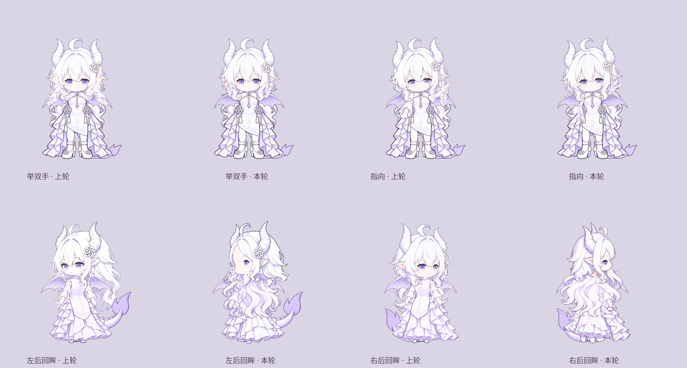
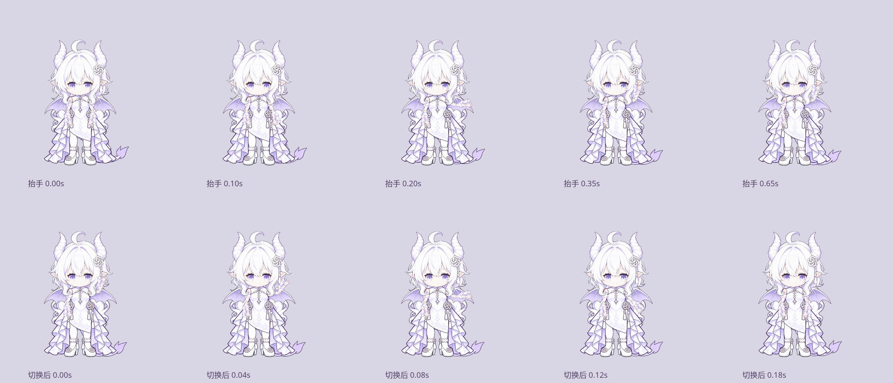
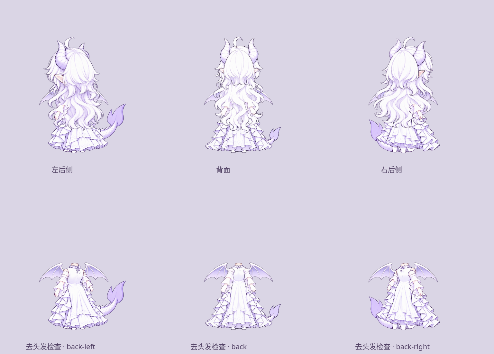

# 第二轮模型细节修复

2026-10-31，修前提交 `2e16305`，用户 Fork 的 `linux/qt-wayland` 分支。按“检查状态并完成后续几个细节修复”处理首轮遗留的正面肘腕、后侧四肢、发层与衣片。本轮由主上下文实施及检查，没有再调用审查代理。

## 状态检查

起始工作区干净，草稿 [PR #1](https://github.com/ayameaqua/GPT-Niang/pull/1) 开放。上一提交的 Linux、Windows 检查通过；macOS 的 PR 合并检查曾在上游 `worker-liveness.test.mjs` 第79行等待 worker 停止时超时，同提交的 push 检查通过。保留源码，重跑失败任务后通过；没有为了清除状态而跳过测试或修改超时。

这些结果属于修前提交。新提交的 CI 状态以 PR 当前检查为准，本地验证记录如下。

## 修复与可见结果

| 项目 | 实现 |
| --- | --- |
| 肩、肘、腕 | 正面上肢改为专用上臂、前臂袖片、手掌三个部分。人工登记 `rootUV/endUV/scale`，上一段末点直接作为下一段根点，骨长保持不变。抬手过程不再交叉叠两张完整手臂；招手只额外摆腕。 |
| 切换与取消 | 状态机保存当前左右抬手、手形和腕摆参数，0.18秒回落/转入新动作。重复招手、从抬手改为站立/指向/另一手、取消时不瞬间退回待机。 |
| 食指 | 独立食指手片固定在实际腕点，随动作重新求角度，人工指尖/射线对准模型锚点 `[760,280]`。仅张掌与食指两种手形局部淡化，肘腕位置连续。 |
| 后侧四肢 | 补画相机近/远两只后侧手臂和鞋跟，不再将正背手臂/鞋直接拷贝到两个后侧方向。另一侧逐肢镜像，保留解剖左右身份；各片保持自身比例，重新登记肩/髋UV。近脚底969、远脚底963。 |
| 后发深度 | 两个后侧的完整头发源分成后脑和长发显示区域。长发仍覆盖后衣，肩部位于发下，近侧前臂末端位于发前；后脑底缘在源高度54%–60%渐隐，与49%开始的长发区重叠，避免硬切线。正背也只将前臂末端提出发层。 |
| 回眸 | 身体与自己的长发保留，只向同侧侧面头组过渡，头颈点对齐。去掉上一轮用前侧整组长发替换后发的路径；不再露出前向头组下的大片紫色底稿。 |
| 后裙 | 原后侧衣片本身画有尖形围裙，并非状态机误带前衣。重画三张后向衣片为连续后摆和后颈小结，重新注册真实腰线、衣领、肩口。 |
| 小尺寸采样 | 对大纹理使用面积滤波的缩小层级，再由 QPainter 变换，减少袖片/细线在小窗口中的斑点。缓存最多64项，不改源PNG或阈值化透明通道。 |



第一排是举双手、指向；第二排是左右后侧回眸。每一对均为相同时点与尺度的上轮/本轮 Qt 合成，上轮图片取自 `2e16305` 的证据，没有用当前代码伪造旧模型。





去头发检查使用相同 renderer 的 `body` 范围，单独确认后衣、近远手与鞋跟；不据此宣称发下的所有细小衣褶都已完成人工美术验收。

## 验证

- 61项 Python/Qt 测试、5项 Node 适配测试通过。新增/更新回归检查骨长与肘腕连接、逐肢镜像、摆腕不扫动上臂、动作替换/取消/重播连续性、动态腕点的食指射线、缩小滤波和发层区域；测试用几何不替代实际素材视觉检查。
- 真实 `QPA=wayland` 的预览 smoke 退出0，无 QML warning。使用模拟额度，没有查询账户；截图在被忽略的 `linux/test-results/detail-pass/final/native-wayland-front.png`。
- 重新生成8起始方向×30动作接触表、5脸向×19表情和300帧演示。主上下文检查修后八方向、前侧手势/中间帧、动作替换、后侧去头发身体和回眸；没有穷举所有表情×动作×方向组合。
- 8方向×30动作×5时点共1200次边界采样，无空图、无边缘alpha>16；只证明画布边界，不判断造型质量。
- 320像素、300帧离线合成与alpha平均1.99ms，不包含 Quick 上传、合成器、所有DPR或长时运行。动态输入区仍取同一渲染帧。
- `git diff --check` 通过。原版本状态机、额度、设置和 KWin 规则继续沿用；本轮没有加入对话服务或自行车。

固定帧及模型代码/素材清单哈希在 [fix-snapshot.json](evidence/fix-snapshot.json)。最新八视图见 [fix-views-after.png](evidence/fix-views-after.png)。制作源图及提示词在 [source/revision-3](../../models/dragon/source/revision-3/) 和 [PROMPTS.md](../../models/dragon/PROMPTS.md)。源alpha保持，模型组装可复现。

```bash
QT_QPA_PLATFORM=offscreen ./linux/.venv/bin/python linux/tools/assemble_dragon.py
QT_QPA_PLATFORM=offscreen PYTHONPATH=linux ./linux/.venv/bin/python -m unittest discover -s linux/tests -v
node --test linux/tests/adapter.test.mjs
QT_QPA_PLATFORM=offscreen PYTHONPATH=linux ./linux/.venv/bin/python linux/tools/model_detail_evidence.py --out linux/test-results/detail-pass/current
QT_QPA_PLATFORM=offscreen PYTHONPATH=linux ./linux/.venv/bin/python linux/tools/model_review_evidence.py --out linux/docs/model-review/evidence --check-bounds
./linux/run.sh --model-preview --model-view front
```

`model_detail_evidence.py --previous <上轮证据目录>` 可额外生成上轮/本轮对照。上轮证据可用 `git show 2e16305:linux/docs/model-review/evidence/<文件>` 导出；没有旧图时工具只生成当前过渡与后侧检查，不生成虚构修前图。

三段关节是 Qt 栅格分片的连续旋转和连接，不是 Cubism 肌肉/网格绑定。所有新增手势仍先转到正面；其余方向使用已标定的整肢运动。八方向继续保留试验标记；细小饰物的一致性、全部组合逐帧视觉验收及桌面实际交互/长时验收尚未据此完成，见 [VALIDATION.md](../../VALIDATION.md)。
