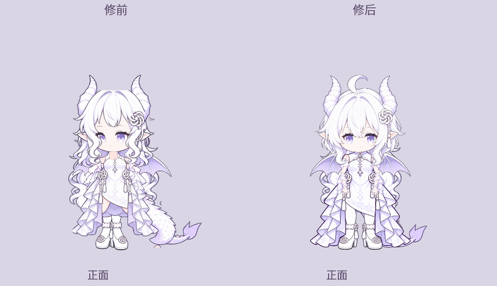
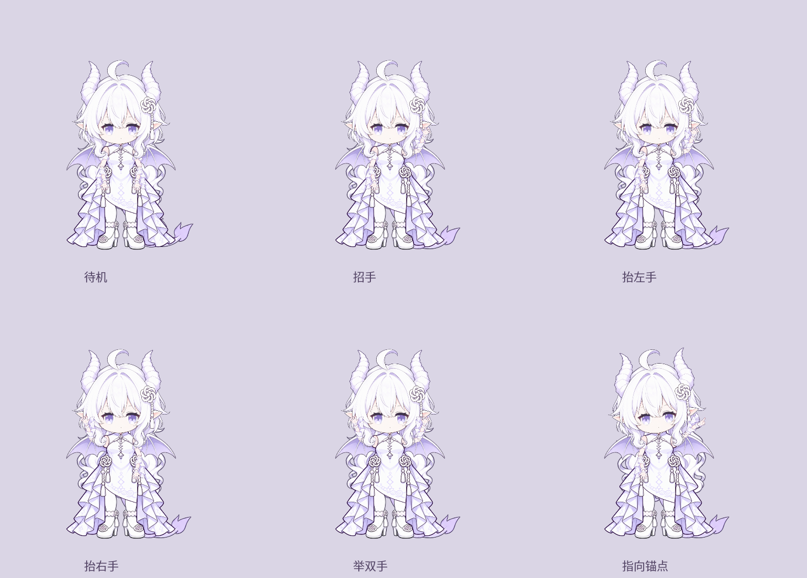
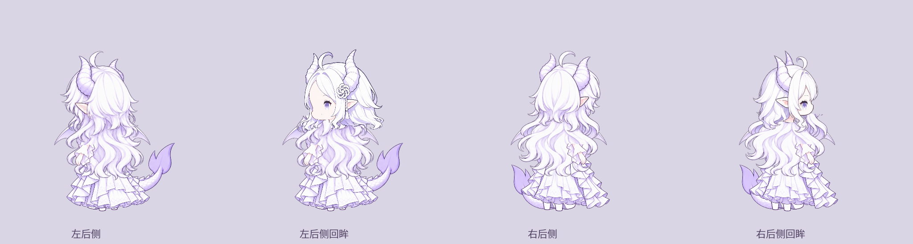

# 按审查顺序实施的模型修复

本文记录首轮处理。肘腕、后侧分片/发层、回眸和缩小采样的后续修复见 [DETAIL-FIXES.md](DETAIL-FIXES.md)；本目录的 `fix-*-after.png` 已更新为当前实现，上轮固定帧仍可从提交 `2e16305` 查看。

2026-10-31。修前运行基线 `a219dc3`；本次在用户 Fork 的 `linux/qt-wayland` 分支修复。三名 GPT-6 Astra / xhigh 审查代理先给出问题，再对正面静态、右前侧绑定、侧后根点及状态逻辑作定向复核；主上下文实施并检查最终 Qt 合成。

这是一轮可运行、可复查的模型修复。八方向继续标为试验绑定；完整模型 V1、连续肘腕变形、全部组合的视觉验收没有据此标记完成。



## 实施顺序与结果

| 顺序 | 修复 | 实际处理 |
| --- | --- | --- |
| 1 | 完整裁片与串格 | `source-selections.json` 逐片定位完整主体，选择连通部件而不按格子截断；清除邻格实心碎片，保留原 RGBA 与邻接抗锯齿。合法分离装饰可显式 include。发梢、腿顶、尾尖不再被旧通用框裁掉。 |
| 2 | 正面静态 | 补画一张完整正面短发头，统一角、耳、结饰、呆毛和脸框发；删除第二张刘海、圆孔补丁及头部上下段拉伸。补正短前摆、侧长裙和透明腿间开口。腿鞋保持本片比例，脚间分开；静止上肢复用原分片，逐肢镜像。 |
| 3 | 右前侧静态 | 新三分之四头不再含烘焙颈胸；新裙恢复短前摆。双腿仅复用并镜像原作者分片，保留 `98×323 / 97×311` 和作者髋点，脚底维持近脚969、远脚963。裙、领、肩与脚组重新注册。 |
| 4 | 全视角绑定 | `rig-layouts.json` 显式记录每个方向的框、枢轴、源内UV与左右身份。根据真实腰部、颈口、肩帽、翼根端面、尾根求位置；修正右侧衣身偏移、后侧翼/尾悬空和右后肩高差。左/右头组围绕颈点等比调整，角顶恢复到65。 |
| 5 | 五官 | 正面双眼中心为370/480、同为60×54，嘴在425；右前侧保留近大远小的透视。独立眉眼、口、腮红与泪点，按皮肤区域遮挡刘海。单眼侧面不再出现第二处泪/腮红；自然眨眼连续压合，生气和认真使用不同眼、眉、嘴形。 |
| 6 | 手势 | 补充张掌与伸食指的专用姿势，左右手逐肢镜像、肩点同步绑定。招手、左右抬手、举双手、指向及跳舞先转正面再播放；掌部在前景可辨。食指依据人工标注的 tip/ray 对准设计坐标 `[760,280]`，重新绑定后仍计算指向角度。 |
| 7 | 状态与持续动作 | 表情身体基础层缓入/缓出，活动手势在峰值持有控制权。拎起高度与四肢保持到释放；落地冲击最后回填到原发片变形。说话、倾听、表情请求分别登记，转向中请求不会丢失，撤销只移除自己的来源。 |
| 8 | 过渡与方向 | 转身/转圈按相邻方向交叉淡化；先给两图各自加权再做预乘加法，修复中点漏底。中途换动作先用0.12秒落到最近方向。坐站用原姿态平滑淡化；左右侧跑步/鞠躬按面向前倾。正面走跑改交替缩短抬脚，衣裙使用腰下轻微连续摆动。 |
| 9 | 回眸 | 新增 `look-back`：身体停在左/右后侧，头组转向肩后，再回正；后发底稿保持在衣服后面，避免把紫色底层盖到胸背。保留身体与双脚位置，取消时头组短暂回落。 |

裁片、图内UV和世界坐标属于不同空间。`landmarks` 中可见根点来自实际纹理；被头发/衣服遮住的后向颈骨、腰髋与尾骨位置是装配判断，报告已区分，不能称作直接测得的皮肤标记。旧的肤色质心关节推断已从组装流程移除。

## 动作适用方向

| 请求 | 处理 |
| --- | --- |
| 招手、左右抬手、双手、指向、跳舞 | 先转正面，使用专用掌部姿势；缺少对应资源时预览按钮禁用 |
| 鞠躬 | 左侧或右侧播放，避免用正面横摆冒充前俯 |
| 坐下、睡觉 | 先转原左前侧，保留原包坐姿和睡眠闭眼 |
| 回眸 | 左/右后侧身体配对应前侧头组 |
| 表情、说话、倾听 | 正面、双前侧和双侧面保留当前方向；后向请求排队转到可见脸方向 |
| 转身、转圈、走跑、歪头、拎起/放下等 | 按当前方向的绑定运行；其余依赖脸的表演仍按状态机转到前侧 |





## 验证与复现

- 52项 Python/Qt 测试、5项 Node 适配测试通过。新增回归覆盖完整主体/内部碎片/合法分离点、源UV到关节的投影、表情与手势控制权、持续拎起、落地发摆、方向前倾、转向请求/替换/撤销、预乘混合中点、食指射线及回眸保留双脚。
- 真正的 `QPA=wayland` 模型预览 smoke 正常退出，无 QML warning；使用模拟额度数据，没有发起账户查询。应用截图仅证明该窗口加载与绘制，不替代桌面合成、真实 seat 拖动或多屏验收。
- 生成8个起始方向的30动作接触表、5个可见脸方向的19表情接触表和300帧演示。主上下文检查静态八视图、前向表情、手势、回眸与若干方向动作；没有把生成所有图片写成逐帧穷举验收。
- 8方向×30动作×5时点共1200次边界采样未发现空图或触碰画布边缘。此项只检查边界，不评价造型。
- 320像素、300帧的离线合成与alpha两次平均约1.6–2.0ms；不含Quick上传、合成器或长时运行。原始中间文件在被忽略的 `linux/test-results/fixes/`。

```bash
QT_QPA_PLATFORM=offscreen ./linux/.venv/bin/python linux/tools/assemble_dragon.py
QT_QPA_PLATFORM=offscreen PYTHONPATH=linux ./linux/.venv/bin/python linux/tools/model_preview.py --out linux/test-results/model --audit --frames
QT_QPA_PLATFORM=offscreen PYTHONPATH=linux ./linux/.venv/bin/python linux/tools/model_review_evidence.py --out linux/docs/model-review/evidence --check-bounds
./linux/run.sh --model-preview --model-view front
```

固定帧证据及实现哈希见 [fix-snapshot.json](evidence/fix-snapshot.json)。修前正面静态来自旧运行基线，保留为 `fix-before-front.png`；重新运行当前代码不会伪造修前模型。

定向复核的原始失败、建议和快照边界保留在 [正面静态](FRONT-STATIC-RECHECK.md)、[右前侧重绑](FR-REBIND-RECHECK.md)、[侧后重绑](SIDE-REAR-REBIND-RECHECK.md)、[状态复核](MOTION-STATE-RECHECK.md)。这些报告早于最终手势、回眸及衣裙摆动，不能替最终实现作未覆盖部分的视觉背书。

继续完善的美术项是连续肘腕变形、后侧分束遮挡、后侧四肢透视及衣褶/饰物的一致性。当前手势采用专用姿势交叉淡化；指向已有模型内锚点，新的对话气泡布局与自行车仍属后续阶段。来源限制沿用 [NOTICE](../../models/dragon/NOTICE.md)。
