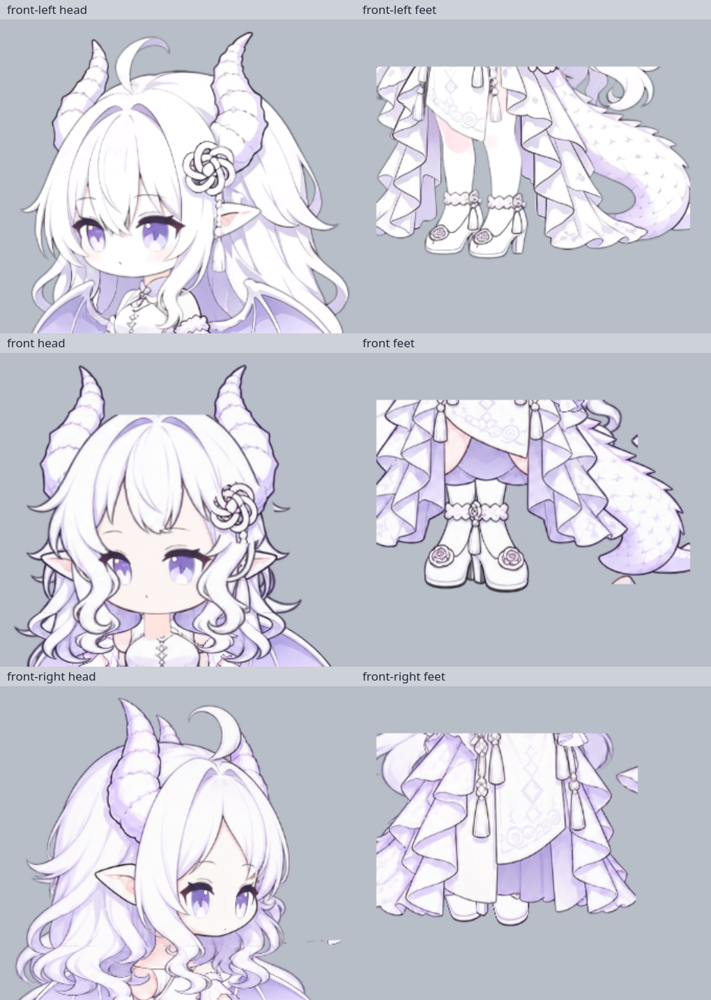
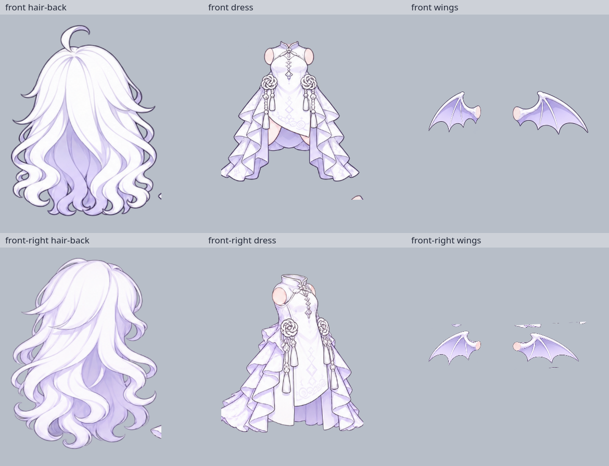
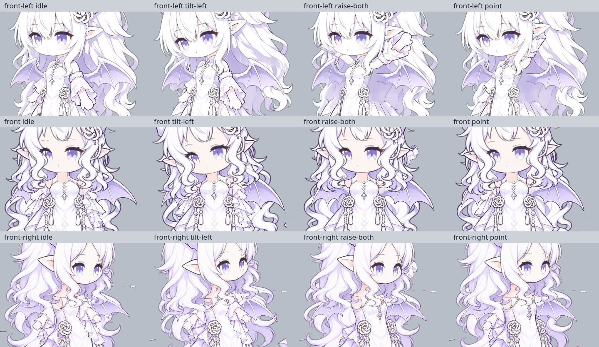

# 前向三个视角视觉与绑定审查

审查对象：`front`、原始基底 `front-left`、`front-right`。基线为 `linux/qt-wayland` 分支 `a219dc3` 的模型和实现；审查日期 2026-10-31。此次仅添加报告、证据和 ignored 诊断产物，未改运行代码、绑定或角色素材，未提交。

**结论：原始 front-left 的静态身份可以继续作为标尺；front 和 front-right 均未达到多视角视觉验收要求。用户指出的正面脚、脸、头发异常成立。最高优先级不是再微调动作曲线，而是修正串格/截断的裁片、局部比例、正面五官和头发分层。三个方向的抬手/举双手/指向还需要独立修正手臂结构和遮挡。**

这里的 P1 表示当前视觉交付的阻断项，P2 表示主结构修复后的对齐项；“可加载”“动作 ID 可调用”和软件测试通过均不表示视觉合格。

## 1. 参考、方法及证据

原造型参考为 `linux/test-results/reference-assets/coopanion-gpt-dragon-thumb.png`，并核对本地导入的 `/home/alazif/.local/share/gpt-niang/models/coopanion-dragon-1.1.0/model.json` 与 30 张 `tex`。原造型的关键特征是：大而柔和的 Q 版头部、原图的眼形/睫毛、白色分节角、解剖左侧结饰与流苏、呆毛、长发、短中央前摆与拖地侧裙、明显露出的双腿和鞋、浅紫蝠翼和有鳞片的弯尾。

渲染使用 `QGuiApplication`、`DragonRenderer(model_directory())`、`Animator`，`QT_QPA_PLATFORM=offscreen`，设计画布 1280，输出 768。静态 `Animator.clock=1`；动作通过 0.025 秒步进推进，避开 `advance()` 单次上限 0.1 秒的误用。**先将透明结果用 QPainter 合成到 `QImage.Format_RGB32` 的 `#b7bec8` 灰底，再查看和裁细节**。所有截图均来自实际运行渲染路径；隔离图仅临时替换内存里的 `parts`，未修改原文件。

完成的目视检查：三个方向静态；左右歪头、左右抬手、双手、指向、招手分别 t=0.4/0.8/1.2 秒；走/跑 t=3.3/3.6/3.9 秒；front 起始的 turn/spin 多帧；三个方向全部 19 个表情的静态接触表。未声称已完成每帧动画、真实桌面缩放或全部其他动作的最终验收。

随仓库保留的三张灰底证据：

1. [脸与脚细节](evidence/front-face-feet-details.png)：每两格一组，依次 front-left、front、front-right。正面平顶刘海、偏斜五官、挤脚，以及右前侧长裙遮腿可直接比较。
2. [隔离部件](evidence/front-isolation-evidence.png)：上排 front，下排 front-right；每排后发、裙装、翅膀。显示脱离主体的实心碎片。
3. [肩颈与手势](evidence/front-gesture-comparison.png)：三排依次 front-left、front、front-right；各排 idle / tilt-left / raise-both / point。双手/指向的掌部遮挡和右前侧头颈一体移动可直接比较。

完整原始诊断保留在 `linux/test-results/review/front/`（ignored）：`static-three.png`、`{view}-actions.png`、`{view}-shoulders.png`、`{view}-expressions.png`、`{view}-isolated.png`、`head-mapping-comparison.png`、`turn-sequence.png`、`spin-sequence.png`、逐帧 PNG、`measurements.json`、`alpha-components.json`。脚本为 `capture.py`、`details.py`、`analyze_pixels.py`、`source_components.py`、`evidence.py`；这些不是交付的测试或修复脚本。

## 2. 总体分项比较

| 项目 | front-left 原基底 | front 正面 | front-right 右前侧 |
| --- | --- | --- | --- |
| 头身比 | 静态整体轮廓与原缩略图一致，可作标尺 | 顶端/脚底名义高度仍接近基底；局部脸宽、前发、肩、鞋比例不一致，不能仅凭总高判断合格 | 顶端/脚底大致保持，但脸变窄、长裙占据下半身，视觉上成为另一种身材 |
| 脸型/五官 | 原眼形、远近眼透视、嘴位置基本保留 | 正面脸上仍是左前侧远小近大的眼睛，嘴偏左，额头/脸颊留白改变 | 整块五官横压到 69.6%，眼睛瘦长；头底图已含刘海，五官没有正确的前发遮挡层 |
| 发片/角/饰物 | 各原层分明，呆毛与结饰身份保留 | 刘海顶部截平；头内侧发、独立前发、后发重复；呆毛藏在后发内且被头遮住；圆形镂空掩饰结饰冲突 | 头内已绘大面积后发/刘海，又加一整片后发；额外后发使下部发量膨胀；结饰远侧不可见本身可以接受，但需各角度连续 |
| 颈肩/手臂 | 静态连接基本成立；大幅举手仍不成立 | 露出的竖直颈段和小手/大袖比例不自然；远手抬起后几乎全藏入头后 | 头片包含颈胸，歪头连带皮肤胸片移动；大肩头、小手、长袖；近远映射沿用原视角 |
| 服装 | 原短前摆+露腿+长侧裙 | 原图花纹有保留，但新增对称臀部皮肤/内层裙瓣；前裙裁片混入尾根碎片影响整体缩放 | 素材已画成中央落地长裙，改变原服装结构；左右侧裙被通用裁框切断 |
| 腿脚 | 原腿长和鞋型稳定，静态可用 | 两腿顶部被切；鞋内侧和踝花挤在一起，鞋跟形成中央尖缝；新鞋的正面透视也需调整 | 双腿被极端横压；裙装遮住膝、踝花与鞋面，实际只剩鞋尖；走跑腿几乎不可读 |
| 翅膀/尾巴 | 轮廓/连接静态基本成立 | 左翼比右翼小很多，正面不对称；尾根大体藏于裙后 | 翅膀沿用左前视的左右大小/枢轴，近远关系不随朝向变；翅膀裁片混入头发/裙边；尾巴翻转但未独立校准尾根 |
| 轮廓/遮挡/锚点 | 静态可作参照，动作还需补前臂与手 | 存在头顶直切、袖口隐藏、两脚黏连、实心漂浮碎片 | 实心漂浮碎片最明显；下摆和腿间遮挡错误；头/胸/发合在同一头片 |

## 3. P1：通用裁框已经截断主体并混入邻格

责任位置：`linux/tools/assemble_dragon.py:48-54` 的 `GENERIC_CROPS`、`:80` 的统一裁片、`:28-31` 的 `trimmed()`；输入是 `linux/models/dragon/source/front-parts.png` 与 `front-right-parts.png`，输出为两个方向目录里的 PNG。

`trimmed()` 只取阈值 alpha 的整体包围矩形，随后复制整块矩形。它既不会剔除邻格部件，也不会补回先被 `atlas.copy(*crop)` 切掉的部分。对于已落入同一矩形的两个物体，再 trim 一次无效。

下面是**源图 alpha≥128 主连通部件的实际范围**，采用 `[x0,y0,x1,y1)`，不是运行时设计坐标：

| 方向/部件 | 源图真实范围 | 当前裁框造成的问题 |
| --- | --- | --- |
| front/head | `[27,25,375,437)` | 主体当前未截断；本身已画侧发，是分层设计问题 |
| front/hair-back | `[403,16,721,472)` | `(400,0,330,500)` 右下同时抓到邻格裙摆 |
| front/dress | `[723,62,1123,450)` | `(730,25,435,475)` 切掉左侧 7 px，又混入 y488 起的尾根 |
| front/arm-far | `[49,477,252,771)` | y480 起裁，肩端顶端损失 3 px |
| front/leg-near | `[142,775,240,1053)` | y780 起裁，腿顶损失 5 px |
| front/leg-far | `[485,775,584,1053)` | 同样损失 5 px |
| front/hair-front | `[752,767,1068,1069)` | y780 起裁，头顶弧线损失 13 px，运行时出现平顶 |
| front-right/head | `[6,19,369,485)` | `(0,0,400,460)` 切掉底端 25 px 的发/颈区域 |
| front-right/hair-back | `[400,16,722,496)` | 右下矩形范围与裙摆相邻区域交错，混入明显三角碎片 |
| front-right/dress | `[707,85,1169,500)` | x730 起裁切左侧 23 px，x1165 截右侧 4 px |
| front-right/arm-near | `[1225,111,1431,484)` | 当前裁到 y480，袖摆底端损失 4 px |
| front-right/leg-near | `[105,770,285,1056)` | 腿顶损失 10 px |
| front-right/leg-far | `[486,767,651,1051)` | 腿顶损失 13 px |
| front-right/wing-far 对应源翼 | `[385,517,696,727)` | y480 起的宽框混入上排发梢 |
| front-right/wing-near 对应源翼 | `[744,532,1029,722)` | 当前框混入上方裙边及底部 y747 开始的刘海 |
| front-right 独立 bangs | `[762,747,1053,1082)` | 源图存在，但 `generic()` 明确只给 front 导出前发 |

注意：上述源图包围框可以作为部件定位依据，**不能把它们不加检查地作为最终矩形裁框**。如后发与裙摆在 x/y 范围交错，即使紧包围框也会抓到邻居。需要选择正确主连通部件/人工明确的部件轮廓并保留抗锯齿边缘，或者重排成彼此隔离的分层源文件。勿对所有素材一律“只留最大块”，那会误删合法的独立饰物。

### 3.1 必须区分低 alpha 噪点和真实碎片

直接查看透明 atlas 时，查看器会让大量极低 alpha 像素显示成彩色/白色斑点。灰底合成后大多数不再可见，不应据此宣称整张生成图存在同等强度的脏背景。实测例：`front/head.png` 有 14,838 个 alpha=1–8 像素，但 alpha≥128 的主体只有一个连通组件。

**然而以下碎片完全不同**：其 alpha≥128，有明确不透明轮廓，灰底实际渲染依旧可见。

| 当前运行 PNG | 主体外 alpha≥128 连通片像素数 | 当前 PNG 内坐标 `[x0,y0,x1,y1)` | 实际表现 |
| --- | --- | --- | --- |
| `front/hair-back.png` | 78 | `[320,401,327,417)` | 右侧发尾旁小楔形 |
| `front/dress.png` | 284 | `[369,426,404,438)` | 脚底/尾下漂浮的肤色半圆，来自尾根邻格 |
| `front-right/hair-back.png` | 526 | `[307,420,330,454)` | 身体右侧悬空的白紫三角裙片 |
| `front-right/wing-far.png` | 662 | `[128,0,189,16)` | 翼上方细碎发片 |
| `front-right/wing-near.png` | 1,680、323、106（另有小片） | `[11,0,129,20)`、`[297,0,326,14)`、`[153,267,197,270)` | 脸旁横向白线、上下孤立碎片 |

`front/dress.png` 的主裙仅占 y0–388，但尾根碎片使总高度成为 438。将这 438 px 统一拉到设计高 507 后，真正裙摆只到 `447 + 388/438 × 507 ≈ 896`，比 box 名义底端 954 短约 58 个设计单位。**污染不仅产生小碎屑，还改变整件衣服的缩放。** 去掉碎片后不能无脑保留原 box，需要重新对齐衣服与肩点。

修复步骤：先为两个前向 atlas 建立独立选区/裁框数据，恢复完整刘海、腿顶、裙边与颈部；再重新导出部件；重新测量有效 alpha 轮廓后重建 box/pivot。裁片验收必须在灰/白/深色三个不透明背景都看一遍，且逐片隔离检查。以“没有非预期高 alpha 连通片”为辅助证据，不能用提高整体透明阈值代替裁片修复。

## 4. front 正面：脸、头发、腿脚及身体

### F1 — 正面五官仍保留原左前透视（P1，映射问题）

`front/rig.json` 的 `face.box=[312,315,230,150]` 只是把原 `_face()` 230×150 的画布整体平移 +42 个设计单位；`render.py:_face()` 内部仍用原始 model.json 各五官框。

得到的眼白中心约为 `(370.5,391.5)` 和 `(477.5,388.5)`，尺寸分别 53×51、65×55；眼宽相差 23%。嘴中心约 x415.5，双眼中心中点 x424；正面头底的皮肤中心约 x432–435，身体肩中点 x444.6。即有原视角的大小眼，又有偏左的嘴，不是正面透视。

修复建议：增加每视角五官 landmark，而不是继续扩大/平移整块 face.box。先确定头/身体共用正面中线，再做双眼、眉毛、嘴独立映射。可从眼中心 x≈383/487、y≈389，眼宽 58–62、眼高 51–55，嘴 x≈435、y≈432 开始人工对齐；这些是本次现有头片上的起始估计，头片修复后需重测。两眉高度与眼距按同一中线对齐。验收时平静/开心/惊讶/嘟嘴/哭泣以及视线左右移动均不偏向一侧，正面双眼投影尺寸差建议≤5%，嘴相对下巴中线误差≤3 个设计单位。

### F2 — 平顶、重复前发、失去呆毛与圆孔补丁（P1，裁片+分层+变形）

`head.png` 自身已有角、耳、结饰和两侧脸框发；`hair-front.png` 又含两侧脸框发；`hair-back.png` 是另一个带完整冠部和呆毛的后脑。三张叠加造成重复 S 卷、鬓发拥挤。正面呆毛属于后发且被头部遮掉，原造型醒目的呆毛在正面消失。

`front/rig.json` 的前发 `box=[225,145,420,350]`，`cutout=[520,250,100,100]` 在前发上直接挖圆洞，以露出头片结饰；隔离图能看到圆形缺口和残留小发钩。这不是沿发饰/发丝轮廓的遮挡。圆孔不能解决同一束头发被画在两个图层的根因。

头片 `warpY=[.73,.83]` 将上 73% 拉到 83%，下 27% 压为 17%；相对统一缩放，上段纵向倍率 1.137，下段 0.630，在设计 y459.25 处换比例。脸与耳/发尾因此采用不同变形，独立五官和前发却不随该非线性映射改变。诊断 `head-mapping-comparison.png` 显示直接删除 warp 会让五官落到错误位置，**所以不能把“删掉 warp”单独当修复**。

修复建议：保留完整头顶弧线，明确 `head/face-base`、`hair-front`、`hair-back`、`horns`、`ornament`、`ahoge` 各层唯一归属；结饰放正确 z 层，删除圆孔补丁；将头片和五官放入同一 landmark 体系。能够用原比例适配的层不做上下两段硬压；如确有形变需求，使用同一局部网格映射脸底与五官。验收左右歪头 ±12°、呼吸/发摆、眨眼和惊讶时，发缝连续，结饰没有圆形缺口，呆毛可见且跟头移动，单束头发不出现双轮廓。

### F3 — 双脚挤连、腿被纵向拉长、腿顶被裁（P1，裁片+比例+站姿）

`leg-near` 现图 98×273 被放到 98×323；`leg-far` 99×273 被放到 97×311。相对纵向缩放的横向比例只有 0.845/0.860。两个 box 是 `[412,646,98,323]` 与 `[342,652,97,311]`，横向重叠 27 个设计单位；鞋内侧、鞋跟和踝花在正面挤成中央一串，原参考能分开的两只脚在这里读成黏连。

修复先恢复完整腿顶，再保持腿/鞋比例，单独确定脚踝与鞋底锚点。若保持当前长腿高度，当前图片等比例目标宽约 116/113，**不可只扩大宽度**，必须同时扩大腿中心距。若保持当前宽度，则高度应接近 273/267，并向下放置以保留脚底 y≈969。更好的做法是拆腿与鞋，在不改变原参考鞋型的前提下分别匹配腿长和正面鞋投影。

正面起始站姿可把踝/鞋中心从目前拥挤状态向两侧各移约 10–16 个设计单位；以鞋轮廓间保留 8–14 个设计单位的可见间隙为准，统一鞋底 y≈963–969。髋点不能仍一律套原 `legFar=[397,675]`、`legNear=[461,675]`，需和新腿顶一起校准。是否需重画鞋头，应在保持比例并分开双脚后决定；现源图双鞋有外翻朝向，不能用挤在一起的站位伪装正面。

### F4 — 肩颈、袖长、裙装和翼形（P1/P2）

- 肩枢轴由 `skin_center()` 自动推断为 `armFar≈[383.83,493.01]`、`armNear≈[505.33,495.58]`；头枢轴仅取其均值 `[444.58,460]`。这是像素肤色均值，不是已确认的解剖转轴。先修裁片和裙的比例，再人工固定肩点。
- `sourceNeck=true` 复用原基底 `neck.box=[409,422,50,81]`。正面头、衣领和身体中线已改变，原 3/4 颈片会露成直立皮肤柱。静态以及采样歪头没有观察到大面积透明断缝，但形状与原参考明显不同；需重新标记下巴中心、颈根与领口，不宜只加长脖子堵缝。
- 新手臂源图把长垂袖与肩到手放在一片内；把整片强塞原 arm 高 202/185 后，手掌/前臂显著变小。原近臂掌端接近 box 底端，新近臂掌端在长袖图中约上半部，统一 box 高度没有相同的解剖意义。
- `wing-far` 285×177 →164×132，横纵比例 0.772；`wing-near` 286×177 →238×142，约保持比例。正面左右翼因此大小明显不对称。可从两翼宽约210–230、高约135–145、围绕脊柱对称布置开始，对齐翼根而非外框；不要仅镜像带有特定朝向的连接面。
- 前裙的对称裸肤楔形、紫色内裙瓣和原图的露腿方式不一致，是源图服装设计差异；裁片修复不能替代设计修正。保留短中央前摆和两侧长裙的身份关系。

## 5. front-right：长裙、细腿、发层和颈胸

### R1 — 腿脚被压到约半宽，且长裙遮掉原本应露的腿（P1，素材+映射）

`leg-near` 180×276 →98×323，横纵比例 **0.465**；`leg-far` 165×271 →97×311，比例 **0.512**。这不是透视略缩窄，而是将宽的侧鞋强塞原窄 box。若保持当前高度而等比例缩放，宽应约211/189；反之保持当前宽度，高仅约150/159。两者都说明现图不能直接照抄基底 box。

与此同时 `source/front-right-parts.png` 的 torso/skirt 本来就画成中央长裙，`dress.box=[225,447,455,507]`、z4 在双腿 z2.4/2.6 前面，遮住绝大多数腿脚。因此单纯移动腿或把腿 z 提到裙前都会产生更严重穿裙。

修复顺序：先恢复原角色的短前摆/两侧长裙结构及可见腿区，再按右前透视重画或适配腿鞋，随后校准髋、踝、鞋底三个 landmark。验收时右前侧与原左前侧是同一件衣服，前摆下能读出两条腿及踝花；鞋头宽度与脚踝粗细不呈半宽拉伸；走跑全周期能区分近腿和远腿。

### R2 — 头片包含刘海、后发和颈胸，分层语义不成立（P1）

源图 prompt 明确要求 blank face/no bangs，实际 `head` 却已有完整刘海、大量后发及脖颈/胸口。代码又给它叠加一整片 `hair-back`，并通过 `if key != 'hair-front' or view == 'front'` 忽略右前侧单独 bangs。结果是：整个发冠/刘海/颈胸跟随 head 刚体，额外后发再做 mesh；两套后发在歪头和发摆时形成不同的轮廓。

`sourceNeck=false` 并不表示没有脖子，而是脖子画死在 head 上。肩颈证据中的 C 形皮肤区随歪头一起旋转，相对衣领/袖根滑动；下部头片还被当前 y460 裁框截断。这里需素材拆分/补足，不能只把 `head` pivot 左右移几像素。

修复：拆出可旋转头部、独立颈片和真正后发；颈根绑定 upper，头在颈顶旋转；前发覆盖眼白，但睫毛/眉毛是否穿发采用与原基底一致的风格规则。若使用源图独立 bangs，则必须先消除 head 里重复的 bangs；不要简单再叠一张。

### R3 — 整块五官横压与遮挡次序（P1/P2）

`face.box=[455,315,160,150]` 且 `flip=true`，把 230×150 的原 face 压成160×150。两只眼中心约 x499.9/x574.3，近/远眼宽45.2/36.9，高仍55/51，嘴约x543。现头部比原左前侧更接近侧转，脸底较窄；其中有源图角度差异，不能把所有问题归为单一 x 缩放。

修复先让头部角度和原左前侧成为对应的三分之四角度，再给眼/眉/嘴独立 landmark。近眼可以从宽52–58、高48–53，远眼宽38–45、高45–50开始比对；让近眼保持原眼形、远眼承担透视缩短，不把整个口鼻/眼睛统一横压。当前 `_render_view()` 将眼和睫毛放 z14/18，而带刘海的 head 是 z10，所以缺少真实刘海遮挡的机制；必须和 R2 一起修。

### R4 — 近远侧四肢/翼与尾根仍套原左前视（P1/P2）

`front-right` 中 armNear 仍在设计 x≈503 的右肩、armFar 在 x≈412；原左前侧近臂在屏幕右侧，转向右前后近臂应按新的解剖可见关系重新指定。`motion.py` 把 raise-left 永远映射到 armNear、raise-right 到 armFar，无按朝向映射，动作的解剖左右语义不可靠。

翅膀继续使用左小右大的旧 box；其中 `wing-near` 的有效主翼只占当前PNG `[0,52,285,242)`，污染改变了 trim 与缩放，名义横纵比例1.388并不代表主翼的实际比例。先净化该图，再校翼根/大小/z。尾巴设置 `flipX=true` 和 box x125，但 tail pivot 仍继承 `[526,683]`；翻转贴图不会同步转换锚点。应记录尾根在源图中的局部坐标，应用同一 flip+scale 得到设计 pivot，检查摆尾和 run 时与骨盆连续。

## 6. 原始 front-left：保留什么、需要修什么

| 检查 | 结论 | 修复责任 |
| --- | --- | --- |
| 静态脸、头发、角、结饰、服装、腿脚 | 与原缩略图基本一致；是三个方向中唯一能直接作造型标尺的静态基底 | 不应为了迁就新增方向的错误比例反向压扁此基底 |
| ±12° 歪头 | 当前采样中头、耳、角、结饰、脸一起移动，颈部仍被合理覆盖；没有发现明显脱头 | 保留结构；补全复位/连续帧确认 |
| raise-left / wave | 近掌能在头侧出现，但整袖同角度刚体旋转，手掌仍是原放松姿态 | `motion.py:215-223` 与原 `arm-near` 分层 |
| raise-right / raise-both | 远掌几乎消失在头后；双手动作视觉上主要只见近手 | 原 armFar z6、head各层更高，现 z 策略与轨迹不能表达双手 |
| point | 掌部抬进头发后，只看到局部袖/指形，未形成可读的指向手势 | 需要独立指向手掌/前臂与目标位置；原素材无食指伸出手势 |
| walk / run | 腿有交替摆幅；已采样帧中未见腿贴图从裙下整体断开，但无膝踝和支撑脚约束，呈扇摆/滑步 | `motion.py:188-198` 仅髋部旋转，需动作结构而非静态换图 |
| 全19表情 | 可辨识基本差异；静态位置保留源布局 | 保持此布局作为新方向逐项对齐参照，不等于全部表情动态验收 |

`front-left` 并没有 `front-left/rig.json`；`views.json` 未登记该名，渲染器走 `_render_source()`，直接使用本地导入 model.json 的原 box/pivot。修复原基底动作时宜加扩展数据/有来源的新增部件，不修改用户导入的唯一原始资产。

## 7. 三方向的动作连接与转向共同问题

| 动作 | 实际视觉结果 | 根因/字段 | 验收要求 |
| --- | --- | --- | --- |
| 静态 | 新方向脚/发/脸已经有上述结构性问题 | 源图、裁片、box、face、z | 静态先逐部位通过，再做动作 |
| 左右歪头 | front 头部层级整体随动，重复发量更明显；front-right 颈胸跟头旋转 | head里含颈胸；头片非线性warp；head父级upper | 下巴/颈/衣领连续，颈根不随头绕圈；角/结饰无相对滑移 |
| 抬左/右手、双手 | 新方向近手非常小，远手消失；双手不具有“双掌可辨”的语义 | 固定 ±110°；一个 arm 包含肩到袖尾；z3/8 低于 head10/前发16 | 两只手掌有明确轮廓，连接肩/肘/腕，按解剖左右正确；抬手不把长袖当手臂长度 |
| 指向 | 三方向均缺少清晰伸指姿态；front/右前侧大部分动作藏在头后 | -145° 单关节旋转，无指向手形；无手目标锚点 | 手指方向与气泡锚点一致、掌部不被头遮没；肩肘腕连续 |
| 招手 | 只有近臂旋转，袖尾跟着刚体上翻；原基底较可读 | 基准-110°叠加±12°；无腕关节 | 肩位稳定，腕/前臂产生招手，长袖重力方向合理 |
| 走/跑 | front 鞋交错/挤连；右前侧几乎只能看到裙下鞋尖；原基底有腿摆但支撑脚滑动 | 单髋角度±16/25°，没有膝/踝、足底约束；新方向dress整体绑定upper | 完整周期至少一只支撑脚接地，腿不穿裙，鞋底不无故大幅穿地；裙可摆但不遮掉全部腿 |
| 转向/转圈 | front、front-left、front-right 切换时换脸型、换裙长、换发量；不是同一身体绕轴转动的感受 | `advance()` 中离散替换 view；0.4秒 turn 通常每0.1秒换方向，spin每0.1秒换方向；无相邻形状插值 | 先对齐八角度同一身份和锚点；再决定可接受的短转场；不以交叉淡化掩盖服装/比例错误 |

`PARENTS` 只让 head/hair/wing/arm 挂 upper，腿和尾巴不随 upper；run 又将 upper 倾斜 -10°。这使躯干、整体新裙与腿/尾根的相对关系变化。原裙有 skirtNear/skirtFar 分层，新方向却只有 `dress parent=upper`，因此其 `skirtFar/skirtNear` 运动参数根本没有对应层。需要先确认骨盆与躯干/裙层边界，再调整父子关系；不建议为消除某一帧缝隙简单把所有层都挂 upper。

此外 `_render_source()` 末尾绘制惊讶/思考/疑惑等状态符号，`_render_view()` 没有同一流程。19表情接触表能看到原基底的符号而新方向缺少。属于 P2 一致性问题，等主体修复后统一表达层。

## 8. 主上下文可直接执行的修复顺序

1. **冻结原 front-left 标尺。** 保留原 model.json、tex 和本次灰底图。建立冠顶、下巴、颈根、两肩、髋、踝、脚底、翼根、尾根的 design landmarks；名义脚底约969、头颈附近460只能当起点，必须对准实际不透明轮廓。
2. **修 extraction。** 替换两个前向视图共用的 `GENERIC_CROPS`，依据第3节独立部件选区导出，不截刘海/腿顶，不混入邻格。保存可复现的每视图裁切/选区数据；不要直接手改 runtime PNG 而让下次 `assemble_dragon.py` 覆盖。
3. **先修最明显的静态资产。** front：完整前发、单份鬓发、独立呆毛/结饰、正确正面眼嘴和双脚间隙；front-right：恢复短中央前摆/露腿、完整头底、拆开颈胸与头/前发/后发、正确腿鞋比例。
4. **重建各向绑定。** 根据干净图像的解剖点写 box/pivot，不从污染外框或肤色均值推出全部关节；腿鞋尽量保持局部等比例，五官使用每视角独立映射。把每方向近远和角色左右建立显式映射；翼/尾翻转时一并变换局部根锚点。
5. **修动作可读性。** 将肩/上臂/前臂/掌与长袖分别建层，补举手/指向所需被遮区域和手形；允许每视角的手部轨迹、z/遮罩不同。先实现一只手完整连接，再双手；不要靠整体把 arm z 提到脸前造成手穿脸。
6. **校走跑。** 静态腿间距与裙结构通过后，再引入膝/踝或适合Q版的有限弯曲；以支撑脚为约束控制抬脚和躯干高度，协调裙摆与尾根。原基底保留原尺寸，避免为了修新增角度改变所有腿的统一比例。
7. **最后校转向与表达。** 同一时刻并排检查 front-left/front/front-right，确认总高、鞋底、腰线、服装开口、发饰所在解剖侧一致后，再调 turn/spin。全部19表情和说话口型重跑目视检查，补统一状态符号。

修改必须落回 `linux/tools/assemble_dragon.py` 的可复现数据/算法以及模型源与 rig，不能只改生成后的某一份 JSON。需要改渲染/动作时，主要位置为 `render.py:_face/_render_view/_joint/PARENTS`、`motion.py:pose/advance`。本报告不建议直接将以上起始坐标批量替换为最终值；修裁片后必须重新量取。

## 9. 视觉验收清单

- [ ] 原 front-left 静态与原缩略图并排保持同一身份；新增方向不再出现短前摆变落地中央长裙的变化。
- [ ] front 真正正面：下巴、嘴、双眼/眉和身体中线一致；两眼投影近似对称，双翼无无理由的远近尺寸差。
- [ ] 头顶、发梢、腿顶、袖摆没有矩形截断；没有圆孔形状的发饰补丁；呆毛、角、结饰/流苏存在且位置连续。
- [ ] 灰/白/深底上无非预期实心碎片；保留必要抗锯齿和半透明发缘。低alpha查看噪点不能与真实碎片混报。
- [ ] 站立两鞋可分辨，鞋底稳定；右前侧可读出腿与踝花。常规局部比例目标 `sx/sy≈0.95–1.05`，超出部分须明确是经过目视确认的透视处理；不再出现0.46–0.51这种未经说明的脚部压缩。
- [ ] 歪头左右到峰值、保持、复位全过程中颈根跟身体、头绕颈顶，衣领/头发/角/结饰连续。高分辨率逐帧查接缝，不能只看两个峰值。
- [ ] 抬左/右、双手、指向、招手的掌部都能辨认；肩肘腕连接；用户点“左手/右手”在所有视角仍是同一解剖手；指向手势能看出指尖和目标。
- [ ] 走跑至少覆盖两个完整步态周期；支撑脚接地，腿不穿裙/黏连，裙摆和尾根连续；没有用裙把异常腿完全遮住。
- [ ] front-left↔front↔front-right 的相邻切换在暂停逐帧与正常速度均检查：脚底/腰线/头部尺度和装饰身份不跳变；当前离散换图不被当作已经平滑转场。
- [ ] 在常用桌宠尺寸和768诊断尺寸各看一次，两个方向19表情、眨眼、说话口型均在脸上，泪水不无故画到颈部；UI功能测试与视觉结论分别记录。

审查结论为“需修复后再审”，不是通过。保留此报告和三张证据，用同一视角、时刻、灰底重新渲染 before/after，最容易判断修补是否确实解决用户看到的脚、脸与头发问题。
