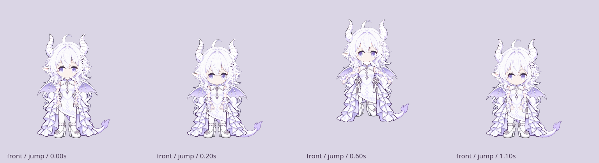

# 第三轮：尾巴与骨骼动作修复

本轮回应侧后／背面尾巴异常、点头像头部平移、跳跃像整图上下移动。基线为 `0e50179fb7e9b09db947739eb04f404f61dbfaae`；继续由三位 GPT-6 Astra / xhigh 子代理只读审查，主上下文修改。此记录取代 WORKING 中的临时实现说明，失败候选报告仍保留。

## 运行版的改变

- **尾巴**：五份原生方向纹理、六节点骨链，尾根随骨盆向后旋转；弯曲与接地旋转保持链长。U形回弯使用轮廓内部的 harmonic 坐标，避免相邻尾段被错误分配到另一根骨。尾叶单独保持形状，侧面末端有独立遮挡；转向先收尾，完全收尾时清掉发隙间残纹。
- **头部**：点头使用固定颈点上的 pitch，摇头使用有限 yaw；脸、刘海、短发和附属角耳共用投影。十二张干净原生头保持整片材质，五官实时绘制；修复镜像方向、红晕/泪位置、耳背取色和独立后颈残留。后侧旧长发上缘只保留480以下并渐显至510，回眸时不再带着另一套短卷。
- **跳跃与步态**：起跳有双足支撑蓄力、伸展、抛物线腾空、收腿和落地吸震；走跑有支撑／摆动脚及骨盆运动。髋膝踝用两段 IK，靴子作为刚性末骨；自由足在需要时按实际 root 旋转后的地面直线修正，避免靠缩鞋补不可达目标。
- **状态衔接**：取消保留当前身体、肢体和表情通道后收回；临接地的短跑弧继续完成，空中重播／互换不重启飞行。拎起后抛落从当前位置释放；睡觉取消先站起、再打开眼睛。手指从实际腕点瞄准当前额度气泡锚点。

## 明确的实现边界

身体转向采用**八向原生帧**，回眸使用十二方向头帧。两者有有限方向帧的切换感，不能称为连续3D旋转。小角度点头、摇头与关节动作仍在每个原生方向内连续变形。手势／跳跃等按现有适用方向路由；例如背向请求 jump 会先转左前侧，不能把它计作独立背向跳跃。

C6–C9试验中出现过网格原点覆盖、全图混色重影、卷发切片、共享发束浮根、侧发变薄及细长衣边。C9共享头发／衣物表面没有采用，运行代码中已删除；独立发束试验资源也未加入发布素材。C12把零星暖色扩大成孔，同样未采用。最终后颈清理按实标ROI选择完整肤色连通域，只扩大该颈块的小范围轮廓；ROI本身不是矩形挖洞。

## 独立审查入口

| 专项 | 报告 | 适用范围 |
| --- | --- | --- |
| 动作 | [C10](PASS3-MOTION-CANDIDATE10.md)、[C11定向](PASS3-MOTION-CANDIDATE11.md) | 30项关键帧、取消、空中互换、抓抛、坐站、世界地面约束 |
| 尾巴／衣发 | [C10](PASS3-TAIL-CANDIDATE10.md)、[C11定向](PASS3-TAIL-CANDIDATE11.md) | 原生衣发恢复、尾链／尾叶／收尾、后发残卷清理 |
| 头部 | [C10及C11](PASS3-FRONT-CANDIDATE10.md) | 原生头恢复、表情及后颈／回眸残留定位；[C14末次定向复核](PASS3-FRONT-CANDIDATE14.md)通过颈块／描边／发线和回眸取消 |

尾巴C10实际查看283帧，C11定向24帧。动作C10查看53表／556单元（其中546为实际API、10为历史／强制Pose诊断）；C11另看10表／102单元。48例空中互换、10例run边界操作、5种拎起释放及12008个坐站姿态都按报告分清了数值、实图与强制边界。历史旋转Pose的足底穿地最大残差修至约 `1.14e-13` 模型单位，不能外推为任意非法外部Pose都有可行解。

## 可复现验证与证据

```bash
QT_QPA_PLATFORM=offscreen PYTHONPATH=linux ./linux/.venv/bin/python -m unittest discover -s linux/tests -q
node --test linux/tests/adapter.test.mjs
npm --prefix gpt-niang-usage test
QT_QPA_PLATFORM=offscreen PYTHONPATH=linux ./linux/.venv/bin/python linux/tools/model_motion_evidence.py --out linux/test-results/pass3 --animation
QT_QPA_PLATFORM=offscreen PYTHONPATH=linux ./linux/.venv/bin/python linux/tools/model_review_evidence.py --out linux/test-results/pass3-bounds --check-bounds
./linux/run.sh --model-preview --model-view front
```

91项Python/Qt、5项Node适配测试通过；共享Node套件161项通过、5项跳过。1200次中性表情画布采样无空图或截边。384px暖缓存渲染与输入mask的40帧均值约21–35ms（各动作详见快照），不能沿用旧版1.99ms数据，也不承诺所有DPR恒定30fps。

Wayland QML smoke退出0；本轮末次原生窗口未暴露，无法重抓原生图，异步抓图会失败退出而不挂住。当前模型预览另在offscreen实际抓图并检查，那个后端不支持原生输入mask，不能据此验收真实指针穿透。

选定实图与运行快照保存于 [evidence/pass3/](evidence/pass3/)。完整中间诊断、冻结代码及几百张接触表在 ignored `linux/test-results/review-pass-3/`；原始报告中的绝对本机链接依赖该目录。只发布合成证据，不发布从用户本机导入包裁出的独立原始素材。




完整V1继续保持未验收：八向造型与细饰一致性、全部表情／动作组合、真实指针穿透与长拖动、多屏缩放及长时间运行仍待验证；对话生成与自行车仍属后续阶段。本轮专项通过与单元测试通过均不等于这些项目完成。
