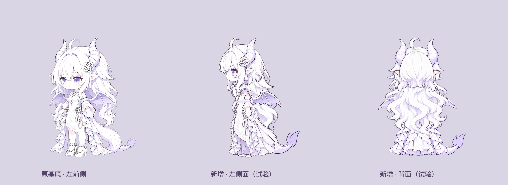

# 龙娘模型工作区

这是现有 Qt 程序的第一轮可动模型实现，**尚未完成计划中的模型 V1**。不依赖 Cubism 或 Coopanion 宿主，不执行外部 JavaScript。

- 原包左前侧：30 个分片、19 种表情、16 种已接入的基线动作。
- 新增：左右歪头、左右抬手、双手举起、指向气泡、拎起保持、放下、画布内抛落、摸头和戳一戳。
- 左侧面、背面：已生成补图并试验绑定，可预览待机、身体/头发/尾巴与适用手势；仍需检查衣摆、关节遮挡和轮廓一致性。表情、口型与不适用动作切回原包左前侧。
- 正面、右前侧、右侧面、左右后侧：只有八方向设定参考，**尚无可用绑定**。预览按钮明确标为待绑定。
- 转身、转圈：八视角尚未齐备，保留 ID 并禁用；不以重复动画冒充完成。因此当前是 16/18 个基线动作。
- 本轮没有实现对话输入/生成服务或自行车。额度气泡沿用现有功能。



## 使用

先运行 `./linux/setup.sh`。从[固定 v1.1.0 发布页](https://github.com/zhengjihuaren/coopanion-gpt-dragon/releases/tag/v1.1.0)下载 `gpt-dragon-v1.1.0.zip`，然后在仓库根目录运行：

```bash
./linux/run.sh --import-model /absolute/path/gpt-dragon-v1.1.0.zip
./linux/run.sh --model-preview
```

导入后需重启已运行的桌宠。重新导入会检查受管目录；发现资源被改动时，先保留 `.backup-时间戳` 目录再修复。导入命令检查固定 SHA-256，将 PNG、JSON 和原包 README 保存至 `$XDG_DATA_HOME/gpt-niang/models/coopanion-dragon-1.1.0`（默认 `~/.local/share`）。它不会安装、导入或执行 `figure.js`。未导入、资源损坏或设置关闭模型时，主窗口使用原静态角色。运行中的新版本可通过 `--model-preview` 打开动作面板。

右键角色也可打开模型预览。面板提供逐项表情/动作、朝向、暂停、0.1–2 倍速、复位、连接点、口型和倾听开关。预览不自动查询账户。关闭预览后桌宠继续运行；右键菜单或设置可退出。主窗口保留原生拖动，拖动触发拎起/放下表现；普通点击显示额度，双击触发摸头表现。长时间原生拖动受原有 1.5 秒 release 看门狗限制，当前无法从普通 Wayland 客户端确认完整的全桌面拖动/抛掷状态。

## 实现与资源

`gpt_niang_linux/model/` 包含独立的确定性动作状态机、QPainter 层级合成、连续纹理变形和 QML 接口。头部与身体有独立枢轴；呼吸、表情、视线、手势、口型和持续坐姿分别计算，不修改角色累计尺寸。纹理按实际 DPR 绘制并限制到源设计画布的分辨率，输入区取同一帧 alpha 的逻辑坐标区域，避免 GPU 回读和过期的静态 mask。纹理变形缓存有上限。

`source/` 是内置 ImageGen 生成的设定图/拆件制作文件。原始拆件图中不适用的躯干单元不使用；背面躯干以单独重绘的 `back-dress.png` 为准。图片查看器可能错误显示低 alpha 像素的彩色或白色噪点，验收使用 Qt 在不透明底色上的真实合成，同时检查 PNG 的 alpha；不要据此直接破坏原始透明通道。

`back/`、`left/` 保存切出的 PNG 与 JSON 绑定；`views.json` 标记其试验状态。图层切割由以下命令从制作文件重现，未在工程脚本中代画角色或补绘隐藏部位：

```bash
QT_QPA_PLATFORM=offscreen ./linux/.venv/bin/python linux/tools/assemble_dragon.py
QT_QPA_PLATFORM=offscreen PYTHONPATH=linux ./linux/.venv/bin/python linux/tools/model_preview.py --out linux/test-results/model --frames
```

第二条命令生成表情/动作接触表、300 帧渲染采样和一组演示帧；采样不代表长时间性能验收。转身/转圈在接触表中也应显示待绑定。

来源及适用限制见 [NOTICE.md](NOTICE.md)，完整生成提示词见 [PROMPTS.md](PROMPTS.md)，实现状态见 [progress.json](progress.json)。完整目标仍以 [实施计划](../../docs/COOPANION-DRAGON-PLAN.md)为准。
